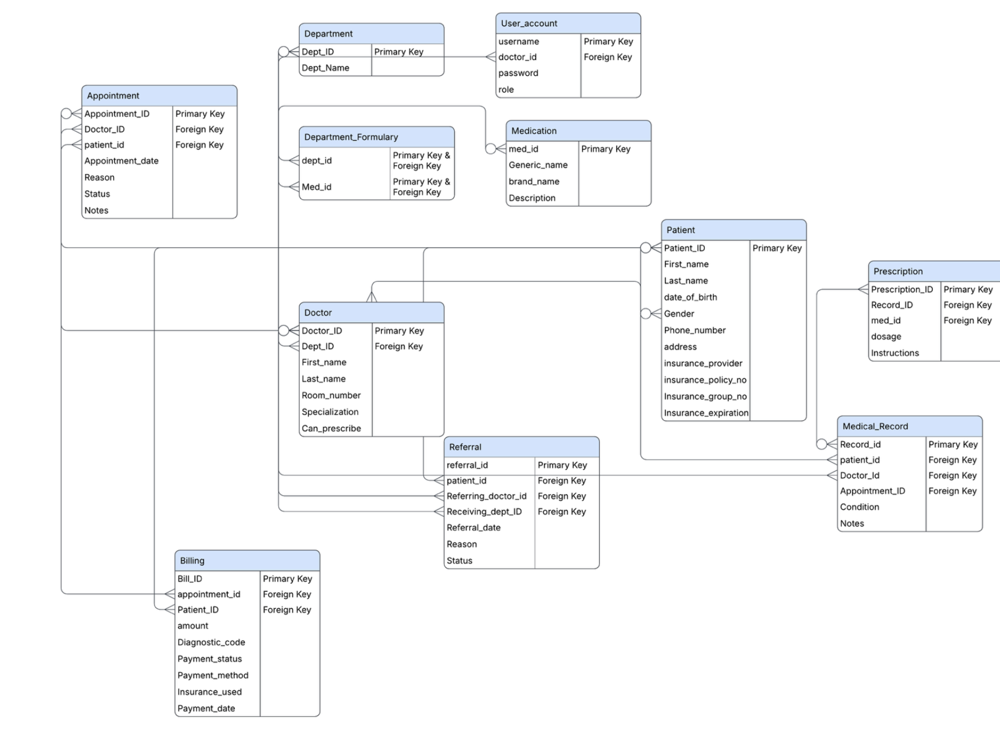

Project Summary: A normalized 11-table Oracle PL/SQL relational database modeling multi-department clinic operations (scheduling, clinical charting, billing, referrals, and department-scoped prescribing)

Architecture Visual: ()

Key Database Features: Highlight your PL/SQL triggers (trg_validate_prescription, trg_no_past_appointments, trg_patient_delete_block), composite keys (department_formulary), PATIENT composite lookup indexes, and role-based views.

Execution Order: List the exact sequence to run your .sql scripts (tables → sequences → indexes → views → triggers → seed_data → queries)

